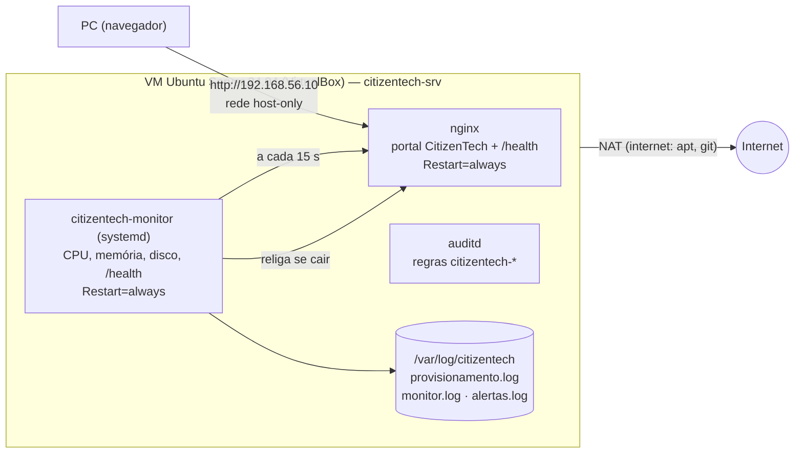

# CitizenTech — Infraestrutura Linux (Operating Systems)

Infraestrutura Linux, provisionada **automaticamente por Shell Script dentro de uma VM**, que hospeda a aplicação web da CitizenTech **CitizenTech Assistente**: o portal de demonstração usado pelo nosso assistente para idosos ([repositório do app](https://github.com/glunghini/citizentech-mobile)).

Um único comando (`sudo bash provisionar.sh`) configura rede, DNS, IP e hostname, instala e publica a aplicação, sobe o monitoramento como serviço tolerante a falhas e liga a auditoria.

**Vídeo de demonstração (até 7 min):** https://youtu.be/U-0w1kUGdmo

## Integrantes

| Nome | RM |
| --- | --- |
| David Alexandre Cordeiro Paixão | 557538 |
| Guilherme Lunghini Teixeira | 556892 |
| Marchel Augusto Ribeiro de Matos | 99856 |
| Tiago Morais Neto | 555619 |
| Vinicius Augusto Siqueira Gonçalves | 557065 |

## Arquitetura



| Item | Configuração |
| --- | --- |
| Sistema | Ubuntu Server 24.04.5 LTS |
| VM | VirtualBox, 2 CPUs, 2 GB RAM, disco de 20 GB |
| Placa 1 | NAT — internet (apt, git, DNS externo) |
| Placa 2 | Host-only — **IP fixo 192.168.56.10/24** (acesso do PC) |
| Hostname / domínio | `citizentech-srv` / `citizentech.local` |
| DNS | systemd-resolved com 1.1.1.1 e 8.8.8.8 |
| Firewall | ufw: só portas 22 (SSH) e 80 (HTTP) |
| Aplicação | nginx servindo `/var/www/citizentech` |
| Usuários e permissões | usuário de sistema `citizentech` (sem login) dono da aplicação (`750/640`, grupo `www-data` só leitura); grupo `citizentech` lê os logs (`/var/log/citizentech` em `2750/640`) |

Todos os valores ficam em [`config/citizentech.env`](config/citizentech.env).

## Como executar

1. Crie a VM no VirtualBox com Ubuntu Server 24.04.5 (2 CPUs, 2 GB, 20 GB) e **duas placas de rede**: Adaptador 1 = NAT, Adaptador 2 = Placa de rede exclusiva de hospedeiro (host-only).
2. Dentro da VM:

```bash
git clone https://github.com/glunghini/citizentech-linux.git
cd citizentech-linux
sudo bash provisionar.sh
```

3. No navegador do PC, abra **http://192.168.56.10**.
4. Teste de falha: `sudo bash testes/teste-falha.sh` (cerca de 3 minutos, testes 1 a 6).
5. Teste de reinicialização: `sudo bash testes/teste-reboot.sh`, depois `sudo reboot`, e depois de religar `sudo bash testes/teste-reboot.sh` de novo (teste 7).
6. Estado geral a qualquer momento: `sudo bash testes/verificar.sh`.

O provisionamento pode ser executado de novo: cada etapa reaplica a configuração.

## O que cada script faz (e o critério que atende)

| Critério (pontos) | Arquivo | O que faz |
| --- | --- | --- |
| Provisionamento da infra: redes, DNS, IP (2) | [`scripts/01-infra.sh`](scripts/01-infra.sh) | Hostname, fuso, `/etc/hosts` (`citizentech.local`), DNS no systemd-resolved, IP estático via netplan na placa host-only, firewall ufw |
| Provisionamento da aplicação: dependências, configurações, orquestração (2) | [`scripts/02-aplicacao.sh`](scripts/02-aplicacao.sh), [`provisionar.sh`](provisionar.sh) | Instala o nginx, cria o usuário e o grupo `citizentech` e define as permissões, grava as variáveis em `/etc/citizentech/app.env`, publica o portal, cria o site e o `/health` e deixa o nginx iniciando no boot; o `provisionar.sh` orquestra as 4 etapas em ordem |
| Monitoramento com alertas de CPU, disco e memória (2) | [`monitor/citizentech-monitor.sh`](monitor/citizentech-monitor.sh) | A cada 15 s mede CPU, memória e disco; registra **ALERTA** acima dos limites (80 / 80 / 85 %) e **RECUPERACAO** ao voltar; confere o `/health` e **religa o nginx** se ele não responder |
| Monitoramento como serviço tolerante a falhas (1) | [`systemd/citizentech-monitor.service`](systemd/citizentech-monitor.service), [`systemd/nginx-reiniciar.conf`](systemd/nginx-reiniciar.conf), [`scripts/03-monitoramento.sh`](scripts/03-monitoramento.sh) | Monitor e nginx com `Restart=always` e sem limite de reinícios; o monitor sobe no boot |
| Logs de auditoria e de execução (1) | [`scripts/lib.sh`](scripts/lib.sh), [`scripts/04-auditoria.sh`](scripts/04-auditoria.sh), [`logrotate/citizentech`](logrotate/citizentech) | Cada comando dos scripts é registrado com data, etapa, usuário e resultado; auditd vigia configurações, aplicação, monitor e rede; rotação diária dos logs |
| Funcionamento completo (2) | [`testes/verificar.sh`](testes/verificar.sh), [`testes/teste-falha.sh`](testes/teste-falha.sh), [`testes/teste-reboot.sh`](testes/teste-reboot.sh) | Verificação de rede, DNS, aplicação, serviços e auditoria; teste de falha com 7 cenários |

## Logs

| Arquivo / comando | Conteúdo |
| --- | --- |
| `/var/log/citizentech/provisionamento.log` | Execução dos scripts: cada comando, usuário, sucesso ou erro |
| `/var/log/citizentech/monitor.log` | Medições a cada 15 s (CPU, memória, disco, aplicação) |
| `/var/log/citizentech/alertas.log` | Só ALERTA, RECUPERACAO e ACAO (religar o nginx) |
| `journalctl -t citizentech-monitor` | Os mesmos registros do monitor no journal do sistema |
| `sudo ausearch -k citizentech-config -i` | Auditoria: quem alterou `/etc/citizentech` (também `citizentech-nginx`, `citizentech-app`, `citizentech-monitor`, `citizentech-rede`) |
| `/var/log/nginx/citizentech-acesso.log` | Acessos à aplicação |

## Teste de falha

`sudo bash testes/teste-falha.sh` executa, em sequência:

| # | Falha simulada | Resultado esperado |
| --- | --- | --- |
| 1 | nginx morto com `kill -9` | systemd religa o nginx em ~3 s |
| 2 | monitor morto com `kill -9` | systemd religa o monitor em ~5 s (PID muda) |
| 3 | nginx parado com `systemctl stop` (o systemd não religa) | o monitor detecta o `/health` fora do ar e religa o nginx |
| 4 | CPU a 100 % | ALERTA de CPU e depois RECUPERACAO |
| 5 | limites de memória e disco baixados para 1 % | ALERTA de memória e disco; limites restaurados e RECUPERACAO |
| 6 | falha controlada num script (cópia de arquivo inexistente) | o erro fica registrado como `[ERRO]` no `provisionamento.log` |

`testes/teste-reboot.sh` (teste 7) registra o boot, pede o `sudo reboot` e, depois de religar, mostra que nginx, monitor e auditd subiram sozinhos e que a aplicação está no ar.

## Evidências

Executado na VM `citizentech-srv` (Ubuntu Server 24.04.5, VirtualBox) em 17/11/2026.

- **Vídeo:** https://youtu.be/U-0w1kUGdmo — provisionamento automático rodando, rede/DNS/IP, aplicação no navegador em `http://192.168.56.10`, monitor como serviço, teste de falha completo e logs de auditoria.
- **Saída completa do teste de falha:** [`docs/evidencias/teste-falha.txt`](docs/evidencias/teste-falha.txt).

Resultado do teste de falha:

| Teste | Resultado obtido |
| --- | --- |
| 1. nginx morto com `kill -9` | fora do ar logo após o kill; **no ar 6 s depois**, religado pelo systemd |
| 2. monitor morto com `kill -9` | **religado pelo systemd** (PID 3142 → 3956) |
| 3. nginx parado com `systemctl stop` | monitor registrou `[ALERTA]` e `[ACAO] nginx religado pelo monitor` em ~15 s; depois `[RECUPERACAO]` |
| 4. CPU a 100 % | `[ALERTA] cpu em 100% (limite 80%)` e depois `[RECUPERACAO] cpu voltou ao normal` |
| 5. limites de memória/disco em 1 % | `[ALERTA]` de memória e disco; limites restaurados e `[RECUPERACAO]` dos dois |

Ao final: `nginx active`, `citizentech-monitor active`, aplicação no ar.

## Estrutura

```
provisionar.sh              orquestra todo o provisionamento
config/citizentech.env      variáveis da infraestrutura
scripts/                    etapas 01 a 04 + funções de log (lib.sh)
monitor/                    script do monitor
systemd/                    serviço do monitor e política de reinício do nginx
nginx/                      site da aplicação
app/                        portal CitizenTech (HTML estático)
logrotate/                  rotação dos logs
testes/                     verificar.sh, teste-falha.sh e teste-reboot.sh
docs/evidencias/            prints e saída real do teste de falha
```
